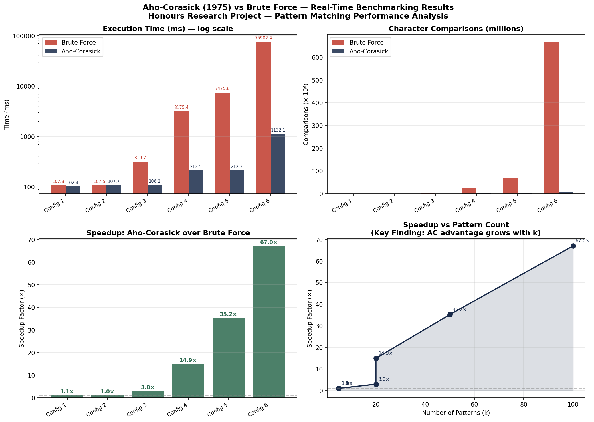

<<<<<<< HEAD
# Aho–Corasick Multi-Pattern Search Benchmark

This project implements the Aho–Corasick string-search algorithm and a brute-force baseline, then benchmarks their behavior on generated DNA-like text and patterns.

## Table of contents

- [Overview](#overview)
- [Features](#features)
- [Demo and sample results](#demo-and-sample-results)
- [Tech stack](#tech-stack)
- [Project structure](#project-structure)
- [Prerequisites](#prerequisites)
- [Installation and setup](#installation-and-setup)
- [Environment variables](#environment-variables)
- [Usage](#usage)
- [Python API](#python-api)
- [Benchmark methodology and results](#benchmark-methodology-and-results)
- [Testing and checks](#testing-and-checks)
- [Available commands](#available-commands)
- [Deployment](#deployment)
- [Troubleshooting](#troubleshooting)
- [Contributing](#contributing)
- [License](#license)
- [Contact](#contact)

## Overview

The project compares two ways to find multiple patterns in a text:

- **Brute force** checks each pattern at every possible starting position.
- **Aho–Corasick** builds a trie with failure links, then scans the text in one pass.

The benchmark generates text and patterns from the DNA alphabet `A`, `T`, `C`, and `G`; embeds some patterns in the text; runs each search three times per configuration; and reports elapsed time, matches, and implementation-specific comparison counts. It is a standalone research/learning benchmark, not a web application or service.

The Aho–Corasick convenience function builds the automaton before searching, so its measured run includes both construction and search.

## Features

- Aho–Corasick automaton with trie transitions, breadth-first failure-link construction, and inherited outputs.
- Brute-force multi-pattern search as a comparison baseline.
- Six deterministic benchmark configurations, with a fixed random seed.
- Live elapsed-time display and average, minimum, and maximum timings.
- Match-set comparison between the two algorithms.
- CSV output and, when Matplotlib is installed, a four-panel PNG report.
- Importable functions for running either algorithm on custom text and patterns.

## Demo and sample results

The workspace includes a benchmark chart:



The chart and [`results.csv`](results.csv) are existing sample artifacts. They appear to come from different benchmark runs: for example, the CSV reports a different final-configuration speedup than the value labeled in the chart. Regenerate both files in the same run before using them as a synchronized report or citing exact numbers.

## Tech stack

- **Language:** Python
- **Standard library:** `collections`, `time`, `random`, `csv`, `sys`, `os`, and `threading`
- **Optional plotting dependency:** Matplotlib

The core search modules and CSV benchmark do not require third-party packages. Matplotlib is imported optionally; without it, the benchmark still runs and writes the CSV, but skips the chart.

## Project structure

```text
.
├── aho_corasick.py       # Aho–Corasick automaton and convenience search function
├── brute_force.py        # Brute-force multi-pattern search baseline
├── benchmark.py          # Data generation, benchmark runner, CSV and chart output
├── results.csv           # Checked-in sample benchmark data
├── benchmark_report.png  # Checked-in sample visualization
└── README.md             # Project documentation
```

Running Python may also create `__pycache__/` bytecode files; they are generated artifacts and are not required to run the project.

## Prerequisites

- Python **3.9 or newer**. The source uses built-in generic type annotations such as `list[str]`.
- Matplotlib is optional and only needed to generate `benchmark_report.png`.
- Git is needed only if cloning from a Git repository. No repository URL is present in this workspace.

## Installation and setup

There is no dependency manifest or package installation step. Create and activate a virtual environment if desired.

If you have the Git hosting URL, clone the repository and change into its directory:

```bash
git clone <repository-url>
cd <repository-directory>
```

Replace the placeholders with the actual URL and directory name; neither is included in this workspace. If you already have the project files, start from the project root instead.

### Windows PowerShell

```powershell
py -m venv .venv
.\.venv\Scripts\Activate.ps1
```

If PowerShell does not recognize `py`, use `python` in its place. If script activation is restricted by your system policy, use the virtual environment's interpreter directly, for example `.\.venv\Scripts\python.exe benchmark.py`.

### macOS or Linux

```bash
python3 -m venv .venv
source .venv/bin/activate
```

### Optional chart dependency

Install Matplotlib in the active environment only if you want the benchmark to generate the PNG chart:

```bash
python -m pip install matplotlib
```

No `requirements.txt` or other dependency file is included.

## Environment variables

The project does not read or require environment variables. Benchmark configuration is defined in `benchmark.py`.

## Usage

Run the complete benchmark from the project root:

```bash
python benchmark.py
```

The script runs six configurations with three repetitions per algorithm. It prints live timing updates and a summary, then writes or replaces `results.csv` and (if Matplotlib is available) `benchmark_report.png` beside `benchmark.py`. The largest brute-force configuration can take a long time; allow several minutes for a full run.

There are no command-line options. To change the workload, edit `CONFIGS`, `REPEATS`, or `SEED` in `benchmark.py`. The current configurations use texts from 10,000 to 5,000,000 characters, 5 to 100 patterns, and pattern lengths from 8 to 12.

## Python API

Both search functions accept a text string and a list of pattern strings. Each returns a pair: a list of `(pattern, start_index)` matches and an integer comparison metric.

```python
from aho_corasick import aho_corasick_search
from brute_force import brute_force_search

text = "ushers"
patterns = ["he", "she", "hers"]

ac_matches, ac_count = aho_corasick_search(text, patterns)
bf_matches, bf_count = brute_force_search(text, patterns)

print(sorted(ac_matches))
print(sorted(bf_matches))
```

The returned match lists are not guaranteed to have the same ordering; compare them as sets when checking equivalence. `aho_corasick.py` also exposes the `AhoCorasick` class with `build(patterns)` and `search(text)` methods if you want to reuse a built automaton.

## Benchmark methodology and results

For each configuration, the benchmark uses a seeded random generator to create DNA-alphabet patterns and text, then embeds up to the first three patterns. It runs each algorithm three times on the same generated input and records average, minimum, and maximum elapsed times. Pattern/text generation is outside the individual algorithm timers. The Aho–Corasick convenience function constructs a new automaton inside each timed run.

The comparison counters are **not equivalent low-level operation counts**:

- `bf_comparisons` counts character-equality checks made by the brute-force search.
- `ac_comparisons` increments once per input character scanned. It does not count every transition or failure-link check.

Use the counters to understand what this implementation reports, not as a directly comparable count of all internal work. Wall-clock timings are machine- and runtime-dependent. The checked-in CSV and image are snapshots, not a performance guarantee.

## Testing and checks

No automated test suite or test configuration is included. To check that the Python files parse and compile, run:

```bash
python -m py_compile aho_corasick.py brute_force.py benchmark.py
```

To exercise both implementations and have the benchmark compare their match sets, run the full benchmark:

```bash
python benchmark.py
```

## Available commands

| Command | Purpose |
| --- | --- |
| `python benchmark.py` | Run all benchmark configurations; write CSV and, if available, PNG output. |
| `python -m py_compile aho_corasick.py brute_force.py benchmark.py` | Check Python syntax and compile the modules. |
| `python -m pip install matplotlib` | Optional: install the plotting dependency for PNG generation. |

These are direct Python commands; the project does not define package-manager scripts.

## Deployment

There is no server, deployable application bundle, or deployment configuration. Run the benchmark locally with Python. To share the results, distribute the generated CSV and chart along with information about the machine and Python version used.

## Troubleshooting

### The PNG chart is not generated

Install Matplotlib in the same Python environment used to run the benchmark:

```bash
python -m pip install matplotlib
```

Without Matplotlib, CSV generation still works.

### PowerShell does not allow virtual-environment activation

Use the virtual environment's interpreter directly:

```powershell
.\.venv\Scripts\python.exe benchmark.py
```

Alternatively, follow your organization's PowerShell policy guidance; the project does not require activating a virtual environment.

### The full benchmark takes a long time

The brute-force search checks every pattern against many positions in the text, and the largest configuration has a five-million-character text with 100 patterns. Let it finish, or reduce the text lengths/pattern counts in `CONFIGS` while developing.

### Results differ between runs or machines

Elapsed times depend on the machine and Python runtime. The generated inputs are seeded, but timing measurements are not. Running the benchmark overwrites the checked-in result files.

## Contributing

Contributions can improve the algorithms, benchmark methodology, or documentation. Before proposing a change:

1. Keep changes focused and explain their purpose.
2. Run the syntax check and, when practical, the benchmark.
3. Include the Python version and relevant machine details when reporting performance results.
4. Open an issue or pull request in the hosting repository, if one is available.

No contribution-specific rules or hosted repository URL are provided in this project workspace.

## License

No license file or license declaration is included. The project's license is **TODO: specify the applicable license**.

## Contact

No verified author contact details or project links are included. **TODO: add maintainer name or contact information if desired.**
=======
# Aho-Chorasik-paper-implementation
>>>>>>> af61cf06fca31785ee28f647ec76d08d134d106f
